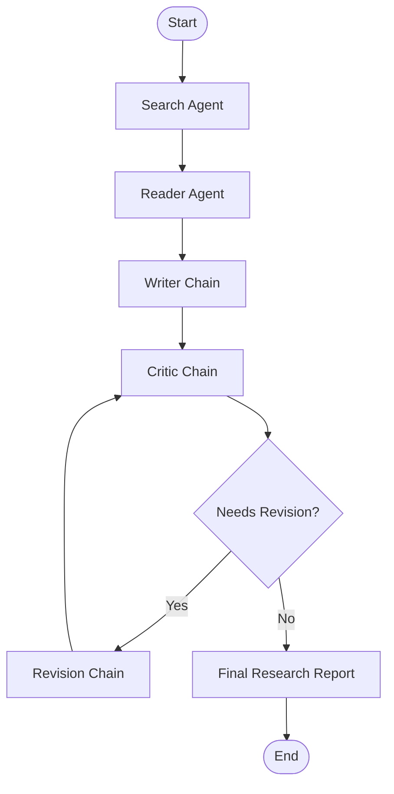

# Multi-Agent Research System 🔍🤖

An AI-powered research application built with **LangChain, LangGraph, and Flask** that automates the research process through multiple specialized AI agents. The system gathers information, analyzes research findings, generates structured reports, and improves the final output through a writer–critic–revision workflow.

## 🚀 Features

- **AI Research Agents:** Specialized agents handle different stages of the research process.
- **Web Search:** Collects relevant information and research sources for a given topic.
- **Research Analysis:** Organizes gathered information into meaningful findings.
- **LangGraph Workflow:** Coordinates agents through a state-based graph.
- **Conditional Routing:** Directs execution based on the workflow's state and evaluation results.
- **Report Generation:** Produces structured research reports based on collected information.
- **Writer Agent:** Generates the initial research report.
- **Critic Agent:** Evaluates the report for quality, relevance, and completeness.
- **Revision Agent:** Refines the report using feedback from the critic.
- **Controlled Revisions:** Uses a maximum revision limit to prevent endless review loops.
- **Flask Web Interface:** Provides a simple browser-based interface for submitting research topics and viewing results.

## 🧠 Workflow Architecture

The system uses LangGraph to manage the research pipeline and coordinate the agents.

1. **User Input:** The user submits a research topic through the Flask interface.
2. **Research:** The search agent gathers relevant information and sources.
3. **Analysis:** The reader agent processes the collected research material.
4. **Writing:** The writer chain generates a structured research report.
5. **Evaluation:** The critic chain reviews the report and determines whether improvements are needed.
6. **Conditional Routing:** LangGraph routes the workflow toward revision or completion.
7. **Revision:** If required, the revision chain improves the report based on the critic's feedback.
8. **Final Output:** The completed report is displayed in the web interface.

### Workflow Diagram



The graph uses conditional edges and a revision limit to control execution and prevent infinite loops.

## 🛠️ Tech Stack

- **Python** — Core programming language
- **LangChain** — LLM integration and chain construction
- **LangGraph** — Agent orchestration, shared state, and conditional workflows
- **Flask** — Backend web framework
- **HTML, CSS, JavaScript** — Frontend interface
- **LLM Provider** — Language model used for research and report generation
- **Search Tools** — External information retrieval

## 📁 Project Structure

```text
multi-agent-research-system/
│
├── app.py
├── pipeline.py
├── agents.py
├── requirements.txt
├── .env
├── .gitignore
│
├── templates/
│   └── index.html
│
└── static/
    ├── style.css
    └── script.js
```

*Adjust the structure above if your actual project uses different filenames or additional folders.*

## ⚙️ Installation

### 1. Clone the repository

```bash
git clone YOUR_GITHUB_REPOSITORY_URL
cd YOUR_PROJECT_FOLDER
```

### 2. Create a virtual environment

```bash
python -m venv venv
```

Activate it on Windows:

```bash
venv\Scripts\activate
```

### 3. Install dependencies

```bash
pip install -r requirements.txt
```

### 4. Configure environment variables

Create a `.env` file in the project root and add the API keys required by your configured language model and search tools.

```env
LLM_API_KEY=your_api_key_here
SEARCH_API_KEY=your_search_api_key_here
```

Replace these example variable names with the exact names expected by your code. Never commit real API keys to GitHub.

### 5. Run the application

```bash
python app.py
```

Open the local URL printed by Flask in your browser, typically:

```text
http://127.0.0.1:5000
```

## 🔄 Why LangGraph?

LangGraph makes the pipeline more than a simple sequence of LLM calls. It allows the application to:

- Maintain shared research state between nodes.
- Define explicit transitions between agents.
- Implement conditional branching.
- Revisit earlier stages when revisions are necessary.
- Enforce workflow limits for more controlled execution.

This architecture makes the research process more organized, extensible, and easier to debug.

## 🔮 Future Improvements

- Parallel research across multiple sources
- Source verification and citation generation
- Persistent research history
- Downloadable PDF and Markdown reports
- Streaming progress updates in the frontend
- Human approval before final report generation
- Improved error handling and retry mechanisms
- Deployment to a cloud hosting platform

## 🎯 Project Goal

The goal of this project is to explore how multiple AI agents can collaborate within a controlled workflow to automate research and generate higher-quality reports.

It combines LLM chains, agent orchestration, conditional graph execution, iterative refinement, and web application development in a practical AI engineering project.

## 👨‍💻 Author

**Asad Ajaz**

Interested in Machine Learning, Deep Learning, Generative AI, RAG Systems, and AI Agent Development.

---

*Built as a hands-on project to explore multi-agent AI systems and LangGraph-based workflow orchestration.*
